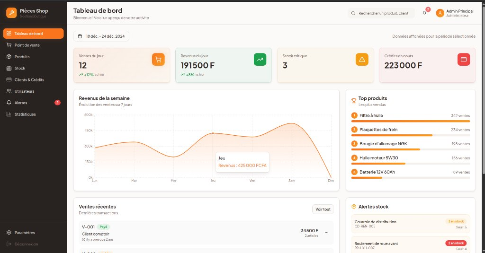
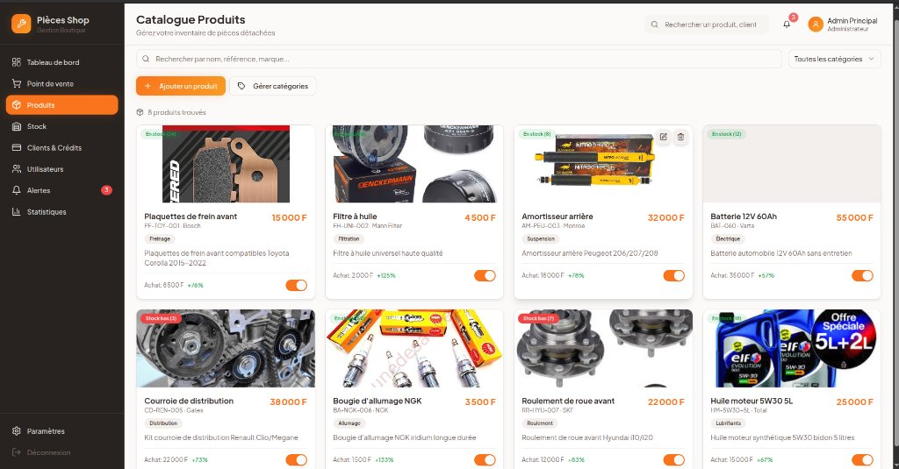
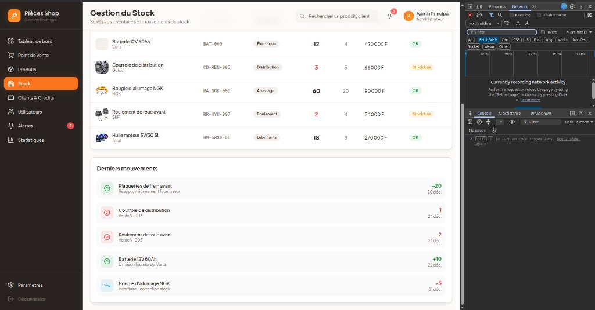
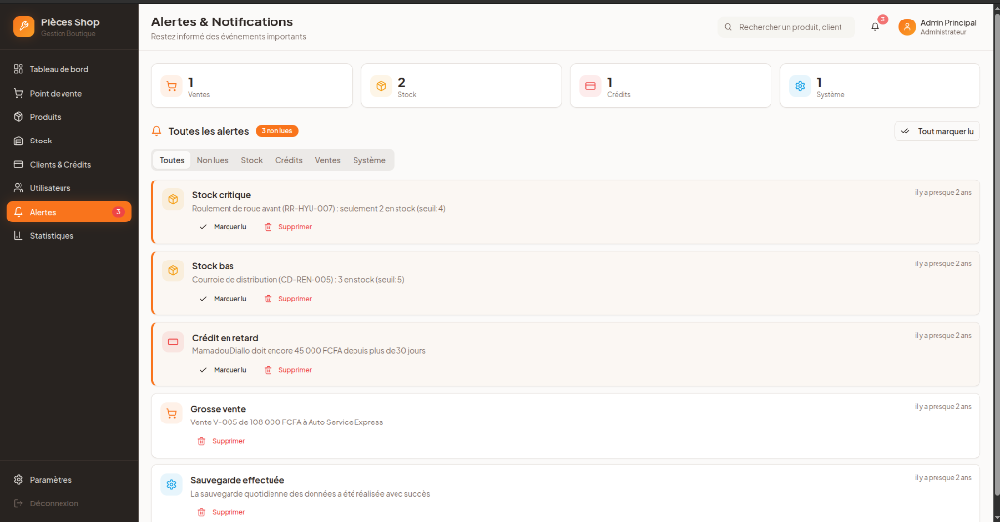
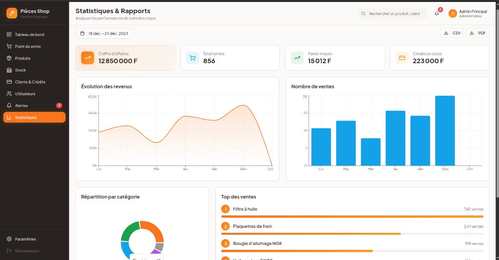
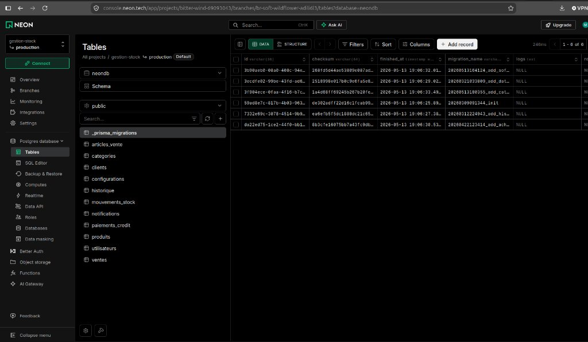

# Pieces Shop - API Backend de Gestion de Stock, Ventes et Point de Vente (POS)

API RESTful performante et securisee concue pour alimenter une plateforme complete de gestion commerciale, de suivi d'inventaire en temps reel, de gestion des points de vente (POS) et de suivi des creances clients.

L'application repond aux exigences de distribution et de vente au detail (commerce de pieces detachees et quincaillerie) en assurant la continuite de service, l'integrite transactionnelle des stocks et la confidentialite des donnees financieres.



## Apercu Visuel de la Solution











## Architecture Technique

Le backend est developpe selon une architecture en couches (Controleurs, Services, Validateurs, Middlewares et ORM) garantissant modularite, maintenabilite et scalabilite :

- Runtime : Node.js avec Express 5 pour un routage asynchrone rapide et robuste.
- Base de donnees : PostgreSQL Serverless heberge sur Neon Cloud.
- ORM : Prisma ORM 6 pour la definition de schemas types, les migrations automatiques et l'optimisation des requetes relationnelles.
- Securite et Authentification : JSON Web Tokens (JWT) et hachage de mots de passe par Bcrypt avec gestion fine des roles (RBAC : Administrateur et Vendeur).
- Validation des donnees : Schemas de validation stricts avec Zod pour securiser l'ensemble des payloads HTTP entrants.
- Stockage de fichiers : Multer pour la reception et l'organisation securisee des photos de produits et justificatifs.
- Observabilite et Logs : Morgan pour la journalisation des requetes HTTP et table d'audit Trail dediee dans la base de donnees.
- Documentation OpenAPI : Swagger UI integre pour tester et consulter la documentation interactive des endpoints.

## Schema Relationnel et Entites Metier

L'architecture des donnees s'articule autour des entites suivantes :

- Utilisateurs (utilisateurs) : Gestion des comptes, roles (admin, vendeur), coordonnees telephoniques et suivi de la derniere connexion.
- Categories (categories) : Classification hierarchique des articles avec support du soft-delete.
- Produits (produits) : Reference unique, marque, designation, prix de vente, seuil de stock minimal d'alerte, quantite disponible et visuel.
- Clients (clients) : Repertoire des clients, cumul du total des credits accordes et historique des montants rembourses.
- Ventes (ventes) : Enregistrement de chaque transaction au comptoir, calcul dynamique du montant total, du montant regle et du solde restant avec generation automatique du statut (completee, credit, partielle, annulee).
- Articles de Vente (articles_vente) : Lignes detaillees de facture associant les produits aux ventes avec quantites et prix unitaires figes.
- Mouvements de Stock (mouvements_stock) : Tracabilite complete des flux entrants (reapprovisionnements fournisseurs), sortants (ventes) et corrections manuelles d'inventaire (perte, casse, ajustement).
- Paiements de Credit (paiements_credit) : Enregistrement des remboursements echelonnes effectues par les clients debiteurs avec affectation par mode de paiement.
- Notifications (notifications) : Centralisation des alertes systeme selon quatre categories (stock, credit, vente, systeme).
- Historique d'Audit (historique) : Journal immutable tracant chaque action executee sur la plateforme, l'auteur et la date.
- Configurations (configurations) : Parametres globaux dynamiques de la boutique.

## Principaux Endpoints de l'API

L'API est versionnee sous le prefixe `/api/v1` :

### Authentification et Utilisateurs
- POST `/api/v1/auth/register` : Creation d'un compte utilisateur.
- POST `/api/v1/auth/login` : Connexion et emission du jeton JWT.
- GET `/api/v1/auth/me` : Recuperation du profil de l'utilisateur connecte.
- GET `/api/v1/auth/users` : Liste des collaborateurs (reserve aux administrateurs).
- PUT `/api/v1/auth/users/:id` : Mise a jour du statut ou du role d'un collaborateur.

### Produits et Categories
- GET `/api/v1/produits` : Liste des produits avec filtres, recherche textuelle et pagination.
- POST `/api/v1/produits` : Creation d'un produit avec upload d'image.
- GET `/api/v1/produits/:id` : Consultation d'une fiche produit detaillee.
- PUT `/api/v1/produits/:id` : Mise a jour des informations tarifaires ou de stock.
- DELETE `/api/v1/produits/:id` : Suppression logique du produit.
- GET `/api/v1/produits/stock/alertes` : Extraction des produits sous le seuil d'alerte.
- GET `/api/v1/categories` : Consultation des categories d'articles.
- POST `/api/v1/categories` : Ajout d'une nouvelle categorie.

### Ventes et Point de Vente (POS)
- POST `/api/v1/ventes` : Creation d'une vente directe ou a credit avec decrementation atomique du stock.
- GET `/api/v1/ventes` : Historique chronologique des transactions.
- GET `/api/v1/ventes/:id` : Details d'un ticket de vente avec articles associes.
- GET `/api/v1/ventes/stats` : Agregations financieres des ventes par periode.

### Clients et Gestion des Dettes
- GET `/api/v1/clients` : Repertoire des clients enregistres.
- POST `/api/v1/clients` : Fiche de creation d'un nouveau client.
- GET `/api/v1/clients/credits` : Liste filtree des clients disposant d'un solde debiteur actif.
- POST `/api/v1/paiements-credit` : Enregistrement d'un versement pour amortir une dette.

### Stocks et Mouvements
- GET `/api/v1/mouvements-stock` : Journal exhaustif des entrees, sorties et ajustements.
- POST `/api/v1/mouvements-stock` : Regularisation manuelle d'inventaire ou reception de stock.

### Tableau de Bord et Notifications
- GET `/api/v1/dashboard/stats` : Indicateurs de performance (revenus du jour, panier moyen, alertes critiques).
- GET `/api/v1/notifications` : Flux des alertes et notifications systeme.
- PATCH `/api/v1/notifications/:id/lu` : Marquer une notification comme traitee.

## Securite et Gestion des Variables d'Environnement

Pour des raisons de securite industrielle, le fichier reel `.env` contenant les identifiants de connexion a la base de donnees et les cles secretes JWT est exclu du controle de version Git.

Un fichier modele `.env.example` est fourni a la racine du depot. Avant de demarrer l'application, dupliquez ce fichier :

```bash
cp .env.example .env
```

Puis renseignez vos parametres propres :
- `PORT` : Port d'ecoute du serveur Express (par defaut : 3000).
- `DATABASE_URL` : Chaine de connexion a PostgreSQL (PostgreSQL local ou Neon Cloud).
- `JWT_SECRET` : Phrase secrete utilisee pour la signature cryptographique des jetons.
- `JWT_EXPIRES_IN` : Duree de validite du jeton de session (ex. : 24h).
- `DEFAULT_ADMIN_PASSWORD` : Mot de passe attribue automatiquement au compte administrateur racine lors de l'initialisation.

## Guide d'Installation et Demarrage Local

### Prerequis

- Node.js (version 18 ou superieure)
- npm ou bun
- Une instance PostgreSQL active (locale ou distante sur Neon Cloud)

### Etapes d'Installation

1. Cloner le depot :

```bash
git clone https://github.com/maximedefaleouna/backend-application-de-gestion-stock.git
cd backend-application-de-gestion-stock
```

2. Installer les modules Node.js :

```bash
npm install
```

3. Initialiser les variables d'environnement :

```bash
cp .env.example .env
```

4. Generer le client Prisma et synchroniser le schema :

```bash
npm run prisma:generate
npm run prisma:migrate
```

Optionnel : peupler la base avec les donnees de demonstration :

```bash
npm run db:seed
```

5. Lancer le serveur en mode developpement :

```bash
npm run dev
```

Le serveur demarrera sur `http://localhost:3000`.

6. Explorer la documentation interactive Swagger :

Ouvrez votre navigateur sur `http://localhost:3000/api-docs` pour visualiser et executer l'ensemble des routes HTTP.

## Auteur

- Concepteur et Developpeur : Maxime DEFALEOUNA ([@maximedefaleouna](https://github.com/maximedefaleouna))

## Licence

Ce projet est distribue sous licence MIT. Libre a vous de l'utiliser, de l'etendre et de le deployer dans un environnement de production.
